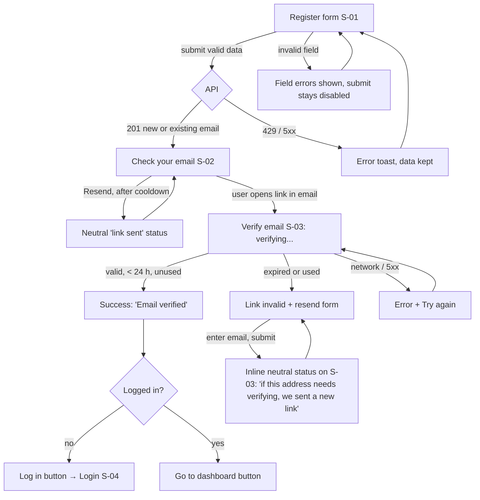
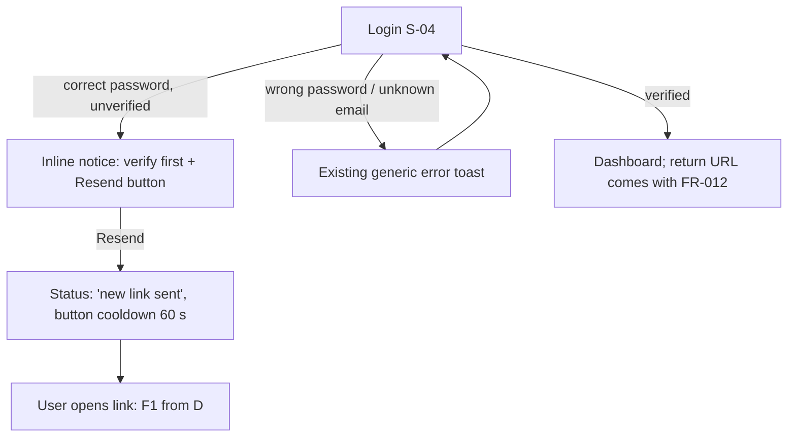
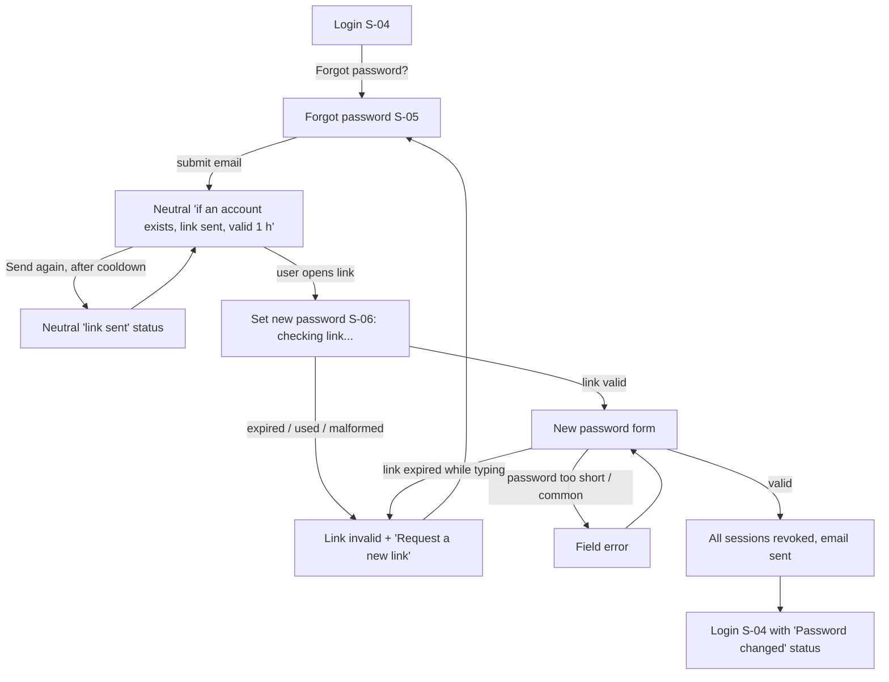
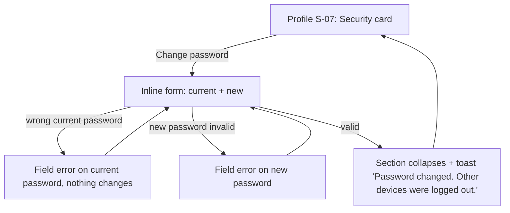
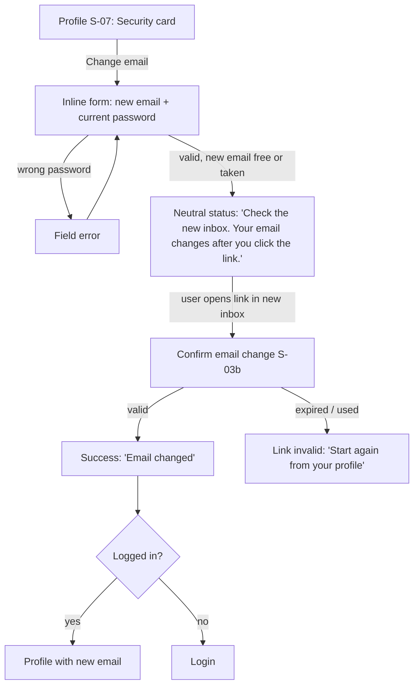
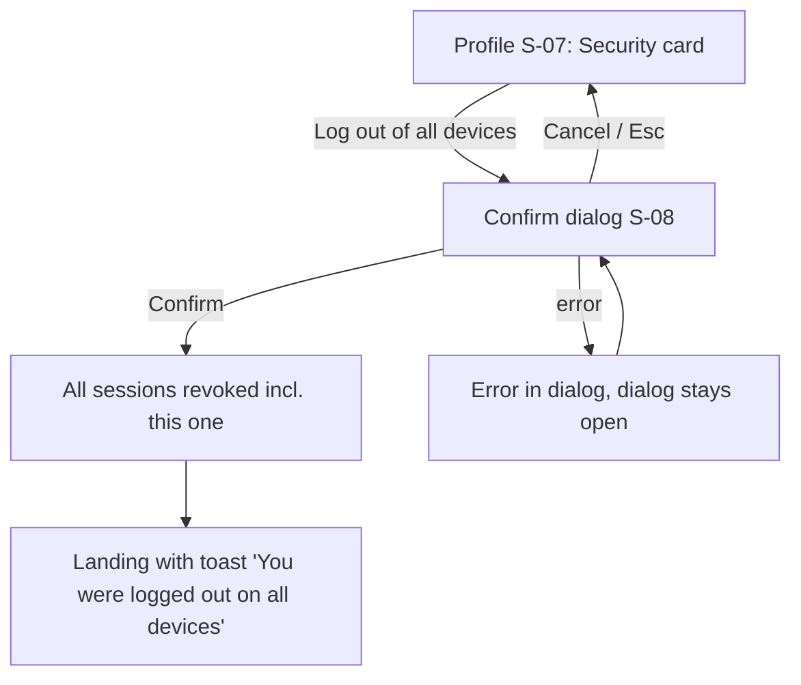
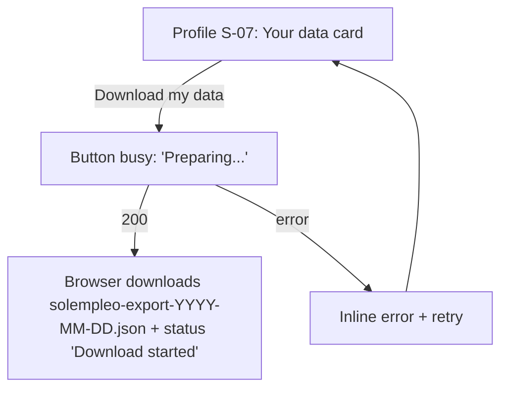
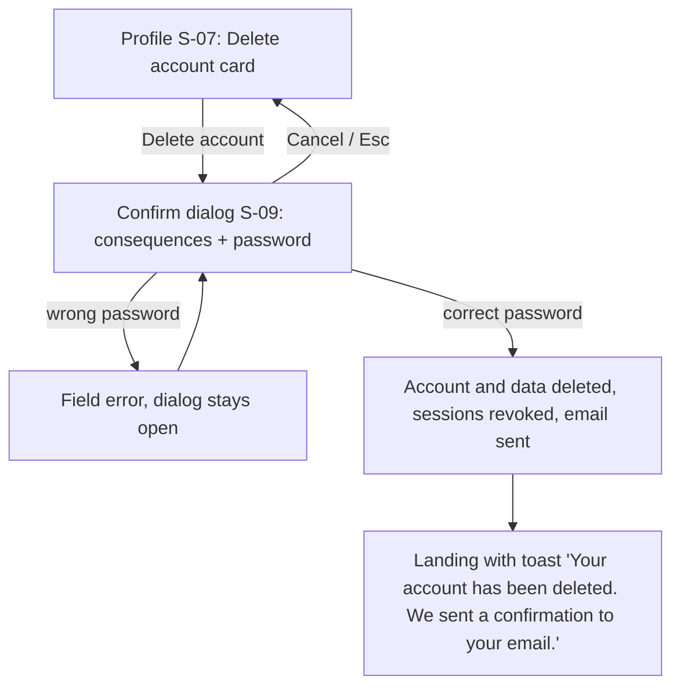
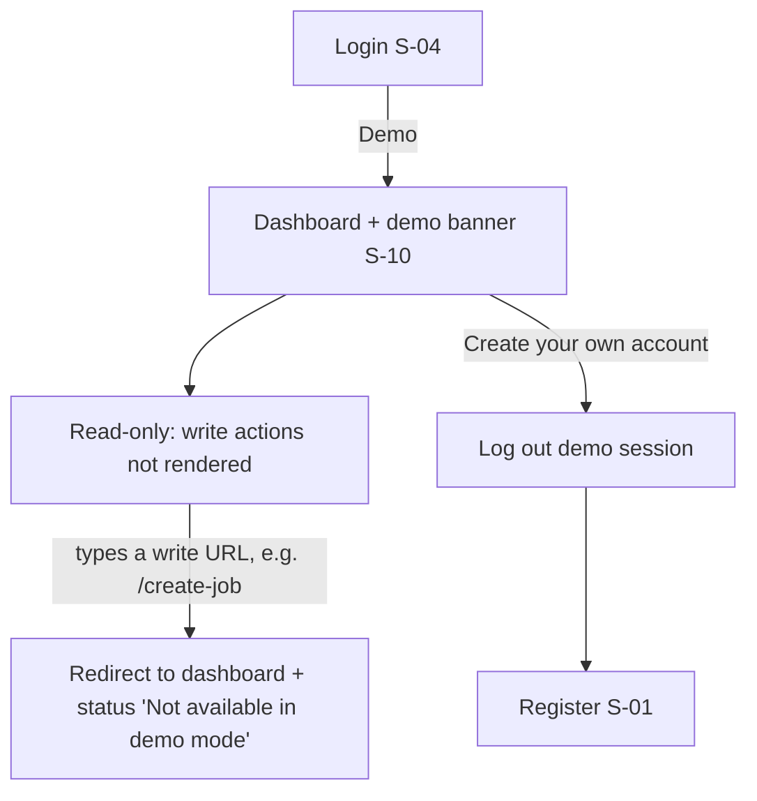
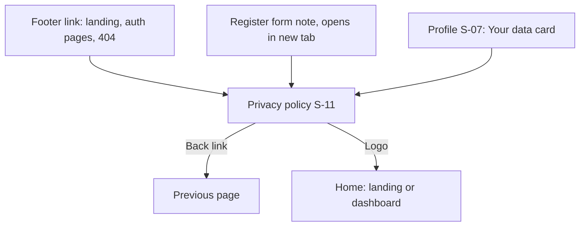

# User Flows: account lifecycle, privacy, demo mode

Scope: only the new flows from the product brief v1.0 (FR-001/002/003 verification parts, FR-005, FR-006, FR-007, FR-009, FR-010, FR-011, FR-013, FR-030). Existing flows (job CRUD, statistics, profile edit) are unchanged.
Screen IDs (S-xx) refer to [SCREENS.md](SCREENS.md).

Conventions for every flow:
- Responses for register, reset request, resend and email change never reveal whether an account exists (NFR-007). The UI shows one neutral message for both cases.
- `429 Too many requests` and network or server errors are shown inline with a retry option; the form keeps what the user typed.

## F1. Register and verify email (FR-001, FR-002)

## F2. Log in with an unverified account (FR-002, FR-003)

## F3. Forgot and reset password (FR-006)

## F4. Change password (FR-007)

## F5. Change email (FR-009)

## F6. Log out of all devices (FR-005)

## F7. Export data (FR-011)

## F8. Delete account (FR-010)

## F9. Demo mode (FR-013)

## F10. Privacy policy (FR-030)

